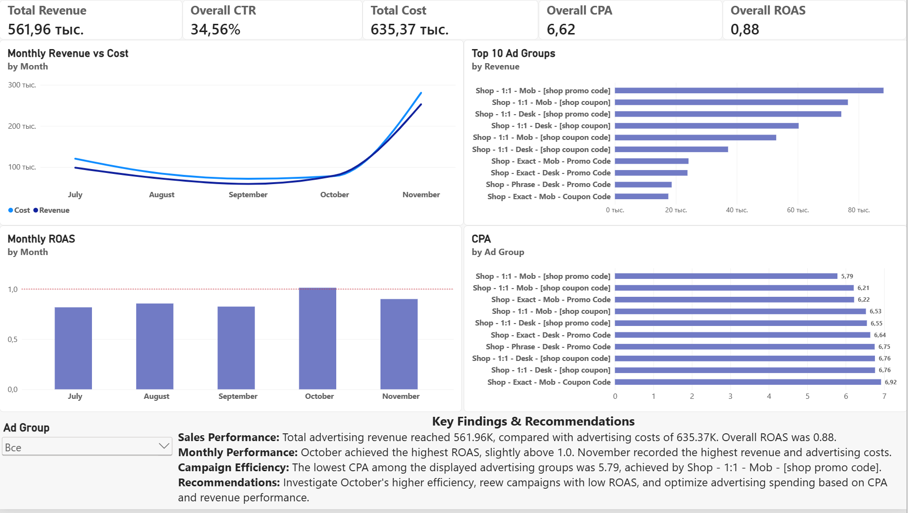

# Marketing Campaign Performance Analysis

## Overview

An exploratory analysis of paid-search advertising performance for a shopping mall using **Python (Pandas, Matplotlib)**, **PostgreSQL**, and **Power BI**. The goal is to compare advertising cost, revenue, conversion performance and efficiency across ad groups and months, and identify opportunities for further investigation.

## Dataset

- Source: [Shopping Mall Paid Search Campaign Dataset (Kaggle)](https://www.kaggle.com/datasets/marceaxl82/shopping-mall-paid-search-campaign-dataset)
- File: `data/final_shop_6modata.csv`
- **190 records**, **40 ad groups**, **July–November 2021**, **12 columns**
- Data checks: **0 missing values**, **0 fully duplicated rows**

The CSV is an aggregated advertising dataset, not individual customer transactions. The `Revenue` field is used as supplied by the dataset. Costs and revenue are expressed in the dataset's unspecified monetary unit; no currency is assumed.

## Tools and workflow

1. **Pandas:** inspect types and nulls, validate data, group by month and ad group, calculate ratios.
2. **PostgreSQL:** aggregate cost, revenue, clicks, conversions and impressions, and calculate marketing KPIs with division-by-zero safeguards.
3. **Matplotlib:** generate monthly comparison charts.
4. **Power BI:** visualize KPIs, month-over-month changes, top ad groups and conversion cost.

## KPIs

| Metric | Value | Calculation |
|---|---:|---|
| Total advertising revenue | 561,960 | Sum of `Revenue` |
| Total advertising cost | 635,372 | Sum of `Cost` |
| Overall CTR | 34.56% | Clicks / Impressions |
| Overall CPA | 6.62 | Cost / Conversions |
| Overall ROAS | 0.88× | Revenue / Cost |

These overall ratios are calculated from **sums**, not by averaging row-level rates. CPA is the cost per dataset-defined conversion, which is not necessarily a new customer acquisition.

## Findings

- Advertising revenue (561,960) was lower than advertising cost (635,372), with an overall **ROAS of 0.88×**.
- **October** had the highest monthly ROAS at approximately **1.01×**, the only month above 1.0×.
- **November** had the largest monthly advertising cost (**280,753**) and revenue (**252,833**).
- Among the ten groups with the largest conversion totals shown in the dashboard, **Shop - 1:1 - Mob - [shop promo code]** had the lowest CPA at approximately **5.79**.

## Recommendations

- Investigate what drove October's better relative efficiency before expanding spending.
- Review the cost and revenue drivers of November's scale-up.
- Compare ad groups using **ROAS, CPA, conversions and volume together**; low CPA alone does not establish overall profitability.
- Validate the definitions of `Revenue`, `Sale Amount`, `Conv Rate` and `P&L` before making financial or attribution claims. The existing rate columns are not treated as authoritative without reconciliation.

## Dashboard



The dashboard includes five overall KPI cards, monthly revenue vs cost, top ten ad groups by revenue, monthly ROAS with the 1.0 break-even reference line, CPA comparison and a group slicer.

To explore it interactively, open the Power BI file once `dashboard/marketing_campaign_analysis.pbix` has been added. The image shown here is a static export and the business conclusions describe the unfiltered dataset.

## Repository contents

```text
marketing-campaign-analysis/
├── README.md
├── data/
│   └── final_shop_6modata.csv
├── python/
│   └── analysis.py
├── sql/
│   └── analysis.sql
├── charts/
│   └── (generated by analysis.py)
└── dashboard/
    ├── dashboard/2 project.png
    └── marketing_campaign_analysis.pbix  # add the final saved report
```

## Reproduce

```bash
pip install pandas matplotlib
python python/analysis.py
```

SQL scripts use a PostgreSQL table named `campaigns`. Import CSV columns into that table using the schema and import guidance in `sql/analysis.sql`. With a PostgreSQL server running, use pgAdmin's Import/Export Data function to load the CSV after creating the table.
